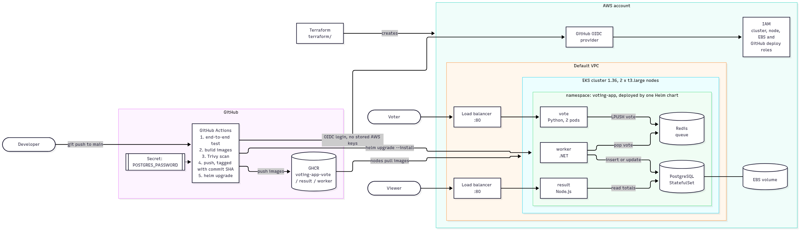

# Voting App: Ship It (DevOps Capstone 1)

A fork of [dockersamples/example-voting-app](https://github.com/dockersamples/example-voting-app)
taken from code to automatic deployment on Kubernetes: hardened containers, an EKS cluster built
with Terraform, a GitHub Actions pipeline that tests, scans, pushes and deploys on every push, and
a Helm chart that can be rolled back.

## The app

| Service | Language | What it does |
|---|---|---|
| `vote` | Python (Flask, gunicorn) | The page where you cast a vote |
| `result` | Node.js (Express, socket.io) | The page showing live totals |
| `worker` | .NET 10 | Moves votes from Redis into PostgreSQL |
| `redis` | Redis 8 | Queue: votes wait here |
| `db` | PostgreSQL 15 | Database: votes are saved here |

Data flow: you vote in **vote** → the vote waits in **Redis** → the **worker** saves it to
**PostgreSQL** → **result** shows the totals.

## Architecture



The diagram source is [docs/architecture.mmd](docs/architecture.mmd) (Mermaid).

## Repository layout

| Path | What's in it |
|---|---|
| `vote/`, `result/`, `worker/`, `seed-data/` | App code and hardened Dockerfiles |
| `docker-compose.yml` | Run everything locally (dev mode, live code reload) |
| `docker-compose.test.yml`, `tests/e2e.sh` | End-to-end test against the production images |
| `terraform/` | EKS cluster in the default VPC, IAM, EBS storage, GitHub deploy access |
| `.github/workflows/ci-cd.yml` | The pipeline |
| `helm/voting-app/` | The Helm chart (one chart, one `values.yaml`) |
| `docs/rollback-demo.md` | Script for the bad-release-and-rollback demo |

## 1. Run it locally

Needs Docker Desktop.

```bash
docker compose up --build
```

- Vote: http://localhost:8080
- Results: http://localhost:8081

Run the end-to-end test against the production images:

```bash
for s in vote result worker; do docker build -t voting-app/$s:test ./$s; done
docker compose -f docker-compose.yml -f docker-compose.test.yml up -d --wait
./tests/e2e.sh
docker compose -f docker-compose.yml -f docker-compose.test.yml down -v
```

## 2. Containers, built safely

- **Pinned base images:** every `FROM` (and the Redis/Postgres images) uses an exact version
  plus its `sha256` digest, so every build starts from the same bytes. End-of-life runtimes were
  upgraded (Node 18 → 24 LTS, .NET 7 → 10 LTS, Python 3.9 → 3.11).
- **Non-root:** every image runs as a numeric non-root user (`vote` 10001, `result` 1000,
  `worker` 1654), so Kubernetes can enforce `runAsNonRoot`. Apps listen on port 8080, because
  non-root users can't bind ports below 1024.
- **`.dockerignore`** in every image folder keeps build files, caches, tests and Git data out.
- **No known fixable HIGH/CRITICAL vulnerabilities:** dependencies were updated until Trivy came
  back clean, and npm (needed only at build time) is removed from the `result` image.

## 3. The cluster, built with Terraform

`terraform/` creates, in the account's **default VPC**:

- an **EKS 1.36** cluster, pinned to standard support (never paid extended support)
- a managed node group of 2 × `t3.large` (Amazon Linux 2023)
- IAM roles for the cluster and nodes (nodes can pull from ECR)
- the **EBS CSI** add-on so PostgreSQL keeps its data on a persistent volume
- a **GitHub OIDC** role that only this repository's `main` branch can use to deploy, so no
  AWS keys are stored in GitHub

```bash
cd terraform
terraform init
terraform apply        # ~15 minutes
$(terraform output -raw configure_kubectl)
kubectl get nodes
```

Rebuild from code at any time:

```bash
terraform destroy      # removes everything it created
terraform apply        # recreates it identically
```

> **Cost:** about $0.27/hour while the cluster exists (EKS control plane + 2 × t3.large).
> Run `terraform destroy` when you're not using it. Before destroying, uninstall the Helm
> release (`helm uninstall voting-app -n voting-app`) so the load balancers and the database
> volume are cleaned up too.

## 4. The pipeline (GitHub Actions)

On every push to `main`, [`ci-cd.yml`](.github/workflows/ci-cd.yml) runs:

1. **Test:** builds the three production images, starts the full stack and runs `tests/e2e.sh`
   (vote, change the vote, check PostgreSQL, load the result page).
2. **Build, scan, push** (vote, result, worker in parallel): builds for `linux/amd64`, scans with
   **Trivy** and fails on any fixable HIGH or CRITICAL vulnerability, then pushes to GHCR as
   `ghcr.io/jayprompts/voting-app-<service>:<commit SHA>`.
3. **Deploy:** logs in to AWS with OIDC and runs `helm upgrade --install` with the new SHA.

Pull requests run steps 1 and 2 without pushing or deploying. Every third-party action is pinned
to a full commit SHA.

**One-time GitHub setup** (Settings → Secrets and variables → Actions):

| Kind | Name | Value |
|---|---|---|
| Secret | `POSTGRES_PASSWORD` | e.g. output of `openssl rand -hex 24` |
| Variable | `DEPLOY_ENABLED` | `true` (turns the deploy job on) |
| Variable | `AWS_ROLE_ARN` | from `terraform output github_actions_variables` |
| Variable | `AWS_REGION` | from `terraform output github_actions_variables` |
| Variable | `EKS_CLUSTER_NAME` | from `terraform output github_actions_variables` |

After the first push, set each `voting-app-*` package in GHCR to **Public** so the cluster can
pull it.

## 5. Deploy and roll back with Helm

The chart in `helm/voting-app/` deploys all five services into the `voting-app` namespace:

- every pod runs non-root, with no Linux capabilities and a read-only filesystem (it passes the
  Kubernetes **restricted** Pod Security Standard)
- the database password comes from a Kubernetes Secret, filled by the pipeline from the
  `POSTGRES_PASSWORD` GitHub secret
- rolling updates use `maxUnavailable: 0`, so a broken release never takes the running one down
- PostgreSQL stores votes on an EBS volume

```bash
helm history voting-app -n voting-app
kubectl get svc vote result -n voting-app     # public addresses
```

The live rollback demo is scripted in [docs/rollback-demo.md](docs/rollback-demo.md): ship a
release with a broken image tag, show the site stays up, then `helm rollback`.

## No secrets in Git

- The production database password lives only in GitHub Secrets and the cluster's Secret.
- The apps read database settings from `PGHOST`/`PGUSER`/`PGPASSWORD`/`PGDATABASE`;
  `docker-compose.yml` sets the well-known local-development defaults only.
- AWS access from GitHub uses OIDC: there are no AWS keys anywhere in GitHub.
- Terraform state and `*.tfvars` are git-ignored.
